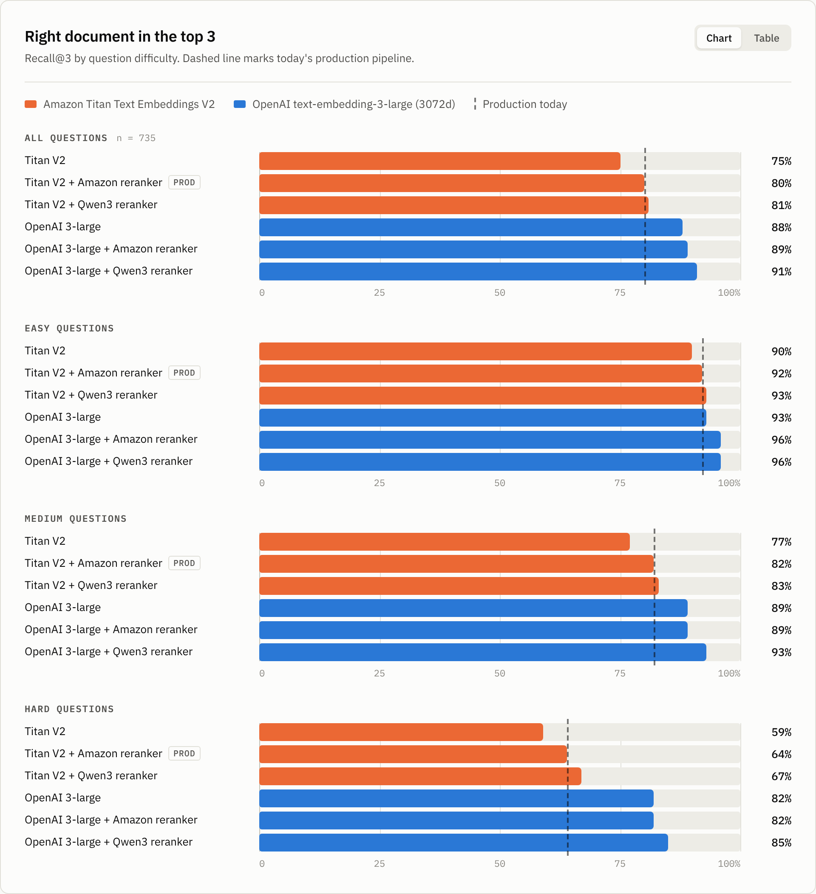

# Does the embedder or the reranker matter more?

A reproducible benchmark for RAG retrieval pipelines. It answers one question
with numbers you can defend: **when top-3 retrieval is not good enough, is the
money better spent on a better embedding model or on a reranker?**

Everything runs through a single OpenRouter key — embeddings, reranking and
the question-generation LLM — over a public corpus, so anyone can re-run it
and get your numbers.



## Quickstart

```bash
pip install -r requirements.txt
export OPENROUTER_API_KEY=sk-or-...

python -m bench models      # which embedding / rerank slugs your key can reach
# paste the ones you want into config.yaml, then:
python -m bench all         # fetch, chunk, generate questions, run, report
```

`all` is five steps you can also run one at a time:

| step | what it does | output |
|---|---|---|
| `fetch` | sparse-clones the corpus | `data/corpus/` |
| `chunk` | heading-aware markdown chunking | `data/chunks.jsonl` |
| `questions` | generates 3 questions per passage, then validates them | `data/questions.jsonl` |
| `run` | the pipeline matrix | `results/run.json` |
| `report` | console summary + refreshes the chart page | `chart/index.html` |

Every API response is cached in `.cache/openrouter.sqlite`. Re-running costs
nothing, a crash halfway through loses no work, and adding a pipeline to the
matrix only pays for what is new.

## What it measures

**recall@3 — is the right document in the top 3?** For each question, the
pipeline retrieves `candidate_k` chunks by cosine similarity, optionally
reranks them, collapses chunks to documents (so two chunks of the same page
cannot eat two of the three slots), and we record the rank of the gold
document.

Reported per difficulty, with a **bootstrap 95% interval** on every figure and
a **paired interval** on every difference against the production pipeline.
That second one is the part most benchmarks skip: with ~700 questions, a
one-point gap is noise, and the paired interval says so out loud.

```
pipeline                 all     easy   medium     hard   95% CI (all)      Δ vs prod (paired)
3-small                  75%      90%      77%      59%   [72%, 78%]    -5 pts [-7, -3] *
3-small + Cohere rerank  80%      92%      82%      64%   [77%, 83%]    +0 pts [+0, +0]  <- prod
3-large                  88%      93%      89%      82%   [85%, 90%]    +8 pts [+5, +11] *
```

## The question set is the experiment

Questions are generated *from* a passage, which biases retrieval towards that
passage. The three difficulty levels exist to control how much of that bias
survives:

- **easy** — the user borrows the page's own vocabulary. High lexical overlap.
- **medium** — same information need, paraphrased, distinctive nouns swapped.
- **hard** — the user describes a symptom or a goal and never names the
  feature. Almost no shared vocabulary.

A model that is really doing lexical matching looks fine on `easy` and
collapses on `hard`. **That spread is the finding.** A single headline number
hides it, which is why the chart breaks every pipeline out by difficulty.

Each generated question then goes through a separate validation call —
answerable from its own passage, self-contained, specific — and roughly
10–20% is dropped. Keeping them would put the same invisible ceiling on every
pipeline in the matrix.

### Honest limits

- Synthetic questions still favour their source passage. The `hard` split
  narrows the gap; it does not close it.
- One corpus, one language, one question generator. Re-run it on your own
  documents before betting a migration on the numbers.
- Retrieval is necessary, not sufficient — none of this measures answer
  quality, latency, or cost per query, and a reranker adds to the last two.

## The corpus

Default is [github/docs](https://github.com/github/docs) (`content/`): about
3,700 public help-centre articles under CC BY 4.0 — the closest public
analogue to an internal customer portal, and small enough to clone in seconds.

To use your own documents, point `corpus` at any repo of markdown/text, or
drop files straight into `data/corpus/` and skip `fetch`:

```yaml
corpus:
  name: "Our product docs"
  repo: "https://github.com/your-org/your-docs.git"
  subdir: "docs"
```

## Configuration

`config.yaml` holds the whole experiment. The pipeline list is the matrix:

```yaml
pipelines:
  - id: large
    label: "3-large"
    embedder: "openai/text-embedding-3-large"
    dimensions: 3072          # only for models that support shortening
    family: challenger        # first family = incumbent, last = challenger
    input_type: false         # true sends search_query / search_document
    production: true          # the baseline every delta is measured against
```

`family` drives the chart's two colours and the headline deltas. `production`
marks the pipeline you run today, so the report answers "what would we gain?"
rather than just ranking models.

## Cost

A full run is dominated by question generation (~1,000 LLM calls), not by the
matrix. Embedding 10k chunks twice and reranking ~700 questions across two
pipelines is the cheap part. Expect a low-tens-of-dollars first run and
near-zero after that, since everything is cached — `bench` prints the exact
spend from OpenRouter's own `usage.cost`, so you never have to guess.

## Layout

```
bench/openrouter.py   embeddings + rerank + chat, with the SQLite cache
bench/corpus.py       markdown -> chunks
bench/questions.py    generation and validation prompts
bench/run.py          the matrix: embed, retrieve, rerank, score
bench/metrics.py      recall@k, MRR, nDCG, bootstrap and paired intervals
bench/report.py       console table + splices data into the chart page
chart/index.html      the published chart; `bench report` refreshes its data
```

The chart's headline and deck paragraph are editorial — `bench report` leaves
them alone and reminds you to re-read them against the new numbers.
